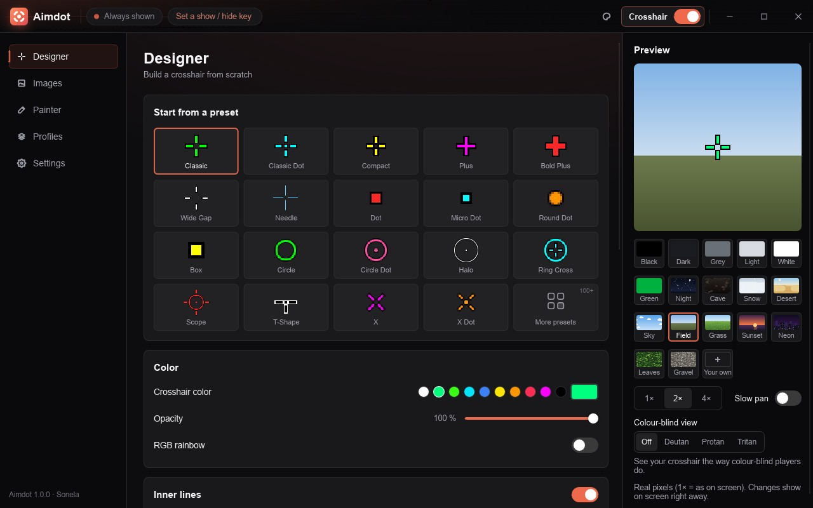
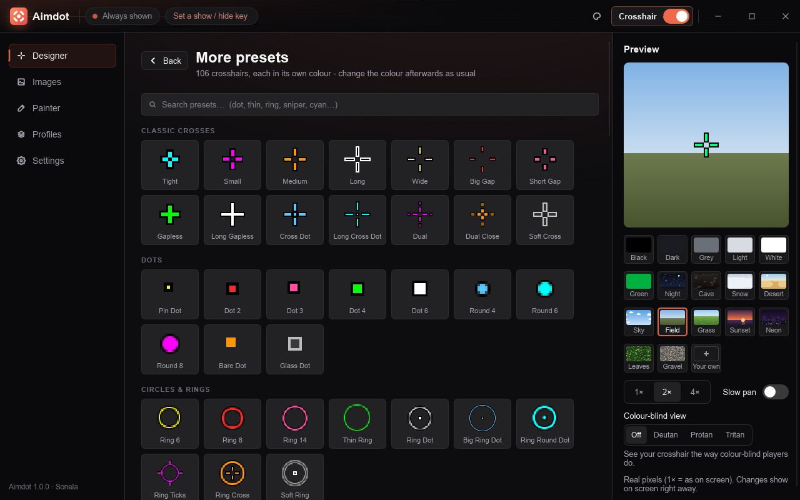
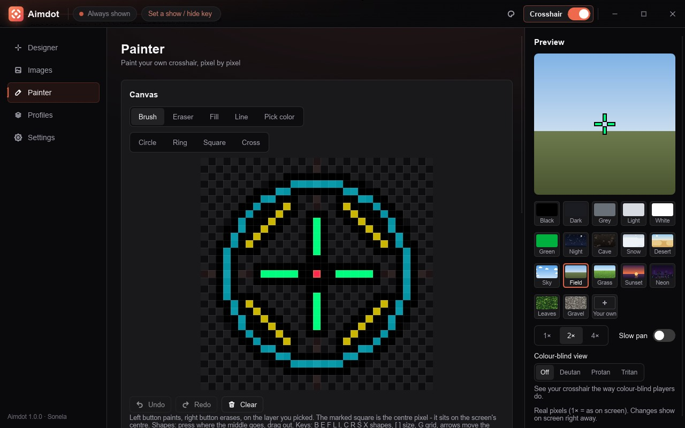

<p align="center">
  
</p>

<h1 align="center">Aimdot</h1>

<p align="center"><b>Your own crosshair on top of any PC game.</b></p>

<p align="center">
  Pick one of 120+ presets, design your own or paint it pixel by pixel. One per game, share codes, CS2 and Valorant import.<br>
  Free, no ads, no account. Open source. Windows and Linux.
</p>

<p align="center">
  <a href="https://sonela.app/aimdot#download"><b>Download Aimdot</b></a> ·
  <a href="https://sonela.app/aimdot">sonela.app/aimdot</a> ·
  <a href="https://discord.gg/JPVewEfUQs">Discord</a>
</p>

<br>

<p align="center">
  
</p>

<br>

<h2 align="center">What it does</h2>

<table align="center">
<tr>
<td width="50%" valign="top">

**Make it yours**
- 19 quick presets + a gallery of 106 more, each in its own colour
- Designer: lines, dot, circle, outline, gap, size, colour, opacity
- Painter: paint pixel by pixel, with layers, symmetry and shapes - even animated crosshairs
- Import a picture (PNG, JPG, SVG, GIF) or a screenshot from another crosshair app
- RGB rainbow, if you like it loud

</td>
<td width="50%" valign="top">

**Stays out of your way**
- A tiny program draws the crosshair; the settings window only runs while it's open
- Show / hide with one key, a different crosshair per game (switches by itself)
- Only while aiming, or hide while aiming
- Smart outline that turns black or white by what's behind it (Windows)
- Hold to zoom around the centre - never shows in clips or Discord streams (Windows)
- Game Bar mode for exclusive-fullscreen games (Windows)

</td>
</tr>
</table>

<p align="center">
  
  
</p>

<p align="center"><sub>Some games don't allow crosshair overlays in ranked - check the rules before you play.</sub></p>

<br>

## Download

Get it from **[sonela.app/aimdot](https://sonela.app/aimdot#download)** or the [latest release](https://github.com/Resister0/aimdot/releases/tag/latest):

- **Windows 10 / 11:** `Aimdot-Setup.exe` installs Aimdot (no admin) and keeps it up to date. No install wanted? `Aimdot-Windows.zip` (portable).
- **Linux:** `Aimdot-x86_64.AppImage` - make it runnable and start it; it updates itself too.

## For developers

| Folder | What |
|---|---|
| `core/` | crosshair engine, settings (INI), PNG decoder, IPC messages - no platform code, no crates |
| `overlay/` | `aimdot`: the small always-running overlay (Windows: Win32; Linux: Wayland layer-shell / X11) |
| `settings/` | `aimdot-settings`: the Slint settings window, started only while open |
| `gamebar-widget/` | Xbox Game Bar widget for exclusive-fullscreen games (Windows, C#) |

```
cargo build --release            # both programs, into target/release
cargo test -p crosshair-core     # engine / config / PNG / IPC tests
```

Run `target/release/aimdot` (opens the settings window too; `--tray` = without it, `--quit` = stop it).
Test copy with its own settings: `CROSSHAIR_HOME=/tmp/ch-test target/release/aimdot` (keep that path short:
the Linux socket lives there).

## Licence

Aimdot is free software: you can redistribute it and/or modify it under the terms of the **GNU General Public
License, version 3 or (at your option) any later version**. See [LICENSE](LICENSE).

The settings window is built with [Slint](https://slint.dev) (used under its GPL-3.0 licence).

<p align="center"><sub>Part of <a href="https://sonela.app">Sonela</a> - free tools for PC gamers. Made by Resister0.</sub></p>
